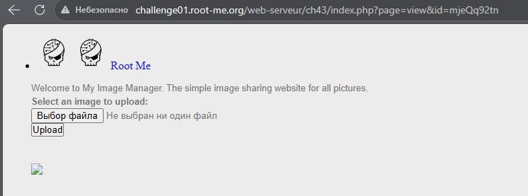
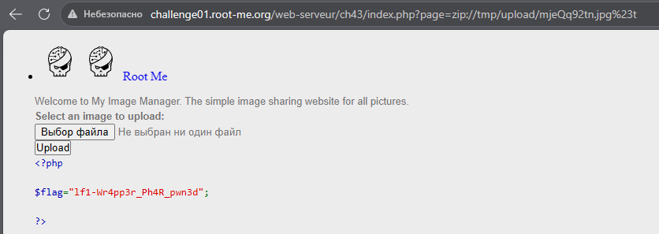

# Root-Me Challenge: Local File Inclusion - Wrappers

## Challenge Description
- **Platform:** Root-Me
- **Category:** Web - Server
- **Difficulty:** 40 points
- **Objective:** Retrieve the flag to validate the challenge.

## Vulnerability Analysis
The application ("My Image Manager") allows users to upload images and view them. The `page` parameter is used to specify the file to display, making it vulnerable to Local File Inclusion (LFI) through PHP wrappers.

The application does not properly validate the `page` parameter, allowing the use of PHP stream wrappers such as `zip://`. This wrapper can be used to read the contents of files on the server, even if they are not traditional zip archives, by specifying the path to the file and an internal entry name.

## Exploitation Steps
1. Navigated to the challenge URL and observed the image upload functionality.
2. Uploaded a file containing malicious PHP code (disguised as a JPG image) to the server. The file was stored in `/tmp/upload/` with a unique identifier (e.g., `mjeQq92tn.jpg`).
3. Identified the location of the uploaded file and used the `zip://` wrapper to access its contents:
   `?page=zip://tmp/upload/mjeQq92tn.jpg%23t`
   Where `%23` is the URL-encoded `#` character, and `t` specifies the internal file entry within the "archive".
4. The application processed the `zip://` wrapper and returned the source code of the uploaded file, revealing the flag:
   `$flag="1f1-wr4pp3r_Ph4R_pwn3d";`
5. Submitted the flag on the Root-Me validation page and successfully solved the challenge.

## Evidence

### Initial Page

### Exploit (Wrapper Bypass)

### Challenge Solved

## Mitigation
To prevent LFI via PHP wrappers:
1. **Disable Dangerous Wrappers:** Configure `allow_url_include=Off` and `allow_url_fopen=Off` in `php.ini` to disable remote file inclusion and dangerous wrappers.
2. **Whitelist Allowed Files:** Only permit access to a predefined set of files, rejecting any input that does not match the whitelist.
3. **Validate Input Strictly:** Ensure that user-supplied input used in file operations does not contain wrapper schemes (e.g., `zip://`, `php://`, `data://`).
4. **Store Uploads Securely:** Store uploaded files outside the web root and serve them through a controlled script that validates file types and content.