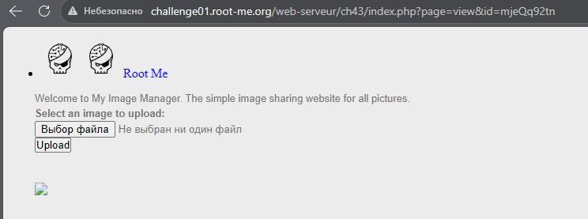
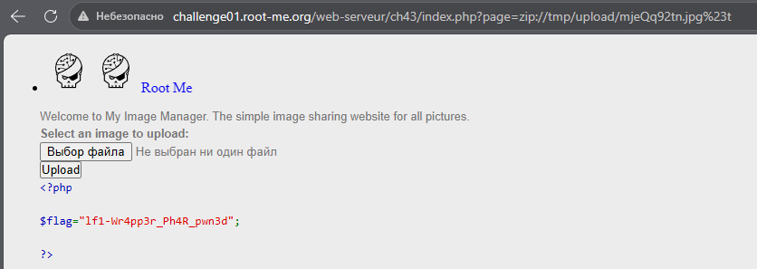

# Root-Me Challenge: Local File Inclusion - Wrappers

## Описание челленджа
- **Платформа:** Root-Me
- **Категория:** Web - Server
- **Сложность:** 40 баллов
- **Цель:** Получить флаг для валидации челленджа.

## Анализ уязвимости
Приложение ("My Image Manager") позволяет пользователям загружать и просматривать изображения. Параметр `page` используется для указания файла, который нужно отобразить, что делает его уязвимым к Local File Inclusion (LFI) через PHP-обёртки (wrappers).

Приложение не проверяет должным образом параметр `page`, что позволяет использовать PHP-обёртки потоков, такие как `zip://`. Эта обёртка позволяет читать содержимое файлов на сервере, даже если они не являются настоящими zip-архивами, указывая путь к файлу и имя внутреннего элемента.

## Шаги эксплуатации
1. Перешли по URL челленджа и изучили функциональность загрузки изображений.
2. Загрузили файл со вредоносным PHP-кодом, замаскированный под изображение JPG. Файл был сохранён в `/tmp/upload/` с уникальным идентификатором (например, `mjeQq92tn.jpg`).
3. Определили расположение загруженного файла и использовали обёртку `zip://` для доступа к его содержимому:
   `?page=zip://tmp/upload/mjeQq92tn.jpg%23t`
   Где `%23` — это URL-кодированный символ `#`, а `t` — имя внутреннего элемента в "архиве".
4. Приложение обработало обёртку `zip://` и вернуло исходный код загруженного файла, в котором был раскрыт флаг:
   `$flag="1f1-wr4pp3r_Ph4R_pwn3d";`
5. Отправили флаг на странице валидации Root-Me и успешно решили челлендж.

## Доказательства

### Исходная страница

### Эксплуатация (обход через обёртку)

### Челлендж решён

## Защита
Для предотвращения LFI через PHP-обёртки:
1. **Отключить опасные обёртки:** Настроить `allow_url_include=Off` и `allow_url_fopen=Off` в `php.ini`, чтобы отключить удалённое включение файлов и опасные обёртки.
2. **Белый список файлов:** Разрешать доступ только к заранее определённому набору файлов, отклоняя любой ввод, не соответствующий белому списку.
3. **Строгая проверка ввода:** Убедиться, что пользовательский ввод, используемый в файловых операциях, не содержит схем обёрток (например, `zip://`, `php://`, `data://`).
4. **Безопасное хранение загрузок:** Хранить загруженные файлы вне корня веб-сервера и отдавать их через контролируемый скрипт, который проверяет тип и содержимое файла.