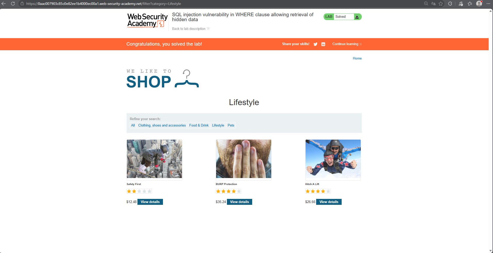
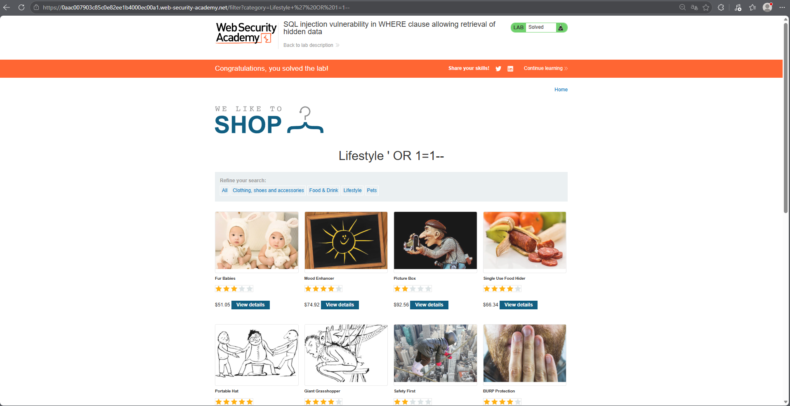

# PortSwigger Lab: SQL injection in WHERE clause (Hidden Data)

## Lab Description
- **Platform:** PortSwigger Web Security Academy
- **Difficulty:** Apprentice
- **Objective:** Perform a SQL injection attack to display unreleased (hidden) products.

## Vulnerability Analysis
The application uses the `category` parameter in the URL to filter products. The backend executes the following SQL query:
`SELECT * FROM products WHERE category = 'Gifts' AND released = 1`

The `category` parameter is concatenated directly into the SQL query. This means we can inject SQL syntax directly via the URL, bypassing the need for a traditional input form.

## Exploitation Steps
1. Selected the "Gifts" category and observed the URL: `/filter?category=Gifts`.
2. To retrieve hidden products (where `released = 0`), we need to neutralize the `AND released = 1` condition.
3. Injected the payload directly into the URL parameter:
   ```sql
   ' OR 1=1--
   ```
4. The final query executed by the database becomes:
   ```sql
   SELECT * FROM products WHERE category = '' OR 1=1--' AND released = 1
   ```
5. The `OR 1=1` makes the condition always true, and `--` comments out the rest of the query. 
6. The application displayed all products, including the unreleased ones.

## Evidence

### 1. Normal State (Before)
Normal category view with only released products visible.


### 2. Payload Execution (After)
The payload `' OR 1=1--` injected into the URL parameter, revealing hidden (unreleased) products.


### 3. Lab Solved
