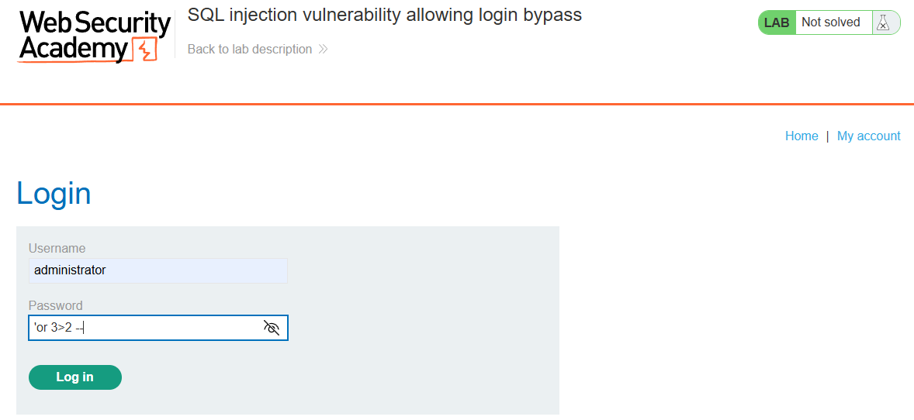
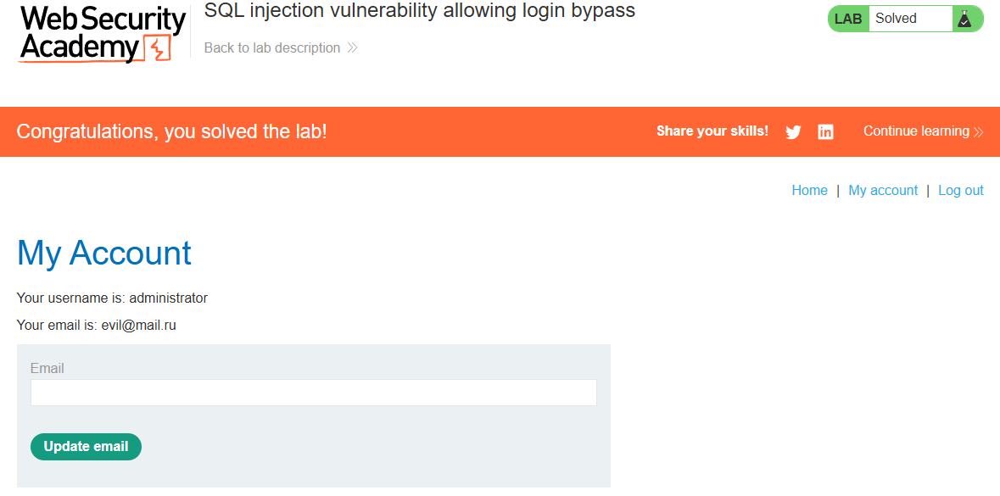

# PortSwigger Lab: SQL injection vulnerability allowing login bypass

## Lab Description
- **Platform:** PortSwigger Web Security Academy
- **Difficulty:** Apprentice
- **Objective:** Perform a SQL injection attack that logs in to the application as the `administrator` user.

## Vulnerability Analysis
The application's login form is vulnerable to SQL injection. The backend likely executes a query similar to:
`SELECT * FROM users WHERE username = 'administrator' AND password = '<input>'`

The `password` parameter is concatenated directly into the SQL query without sanitization.

## Exploitation Steps
1. Navigated to the login page (`/login`).
2. Entered `administrator` as the username.
3. Injected the following payload into the password field:
   ```sql
   ' OR 1=1--
   ```
4. The final query executed by the database becomes:
   ```sql
   SELECT * FROM users WHERE username = 'administrator' AND password = '' OR 1=1--'
   ```
5. The `OR 1=1` condition evaluates to true, and the `--` comments out the remaining part of the query. 
6. The application authenticated the session as the `administrator` user.

## Evidence

### Payload Injection


### Lab Solved


## Mitigation
To prevent this, the application must use **parameterized queries (Prepared Statements)**. Instead of concatenating the input, the query should use placeholders (`?`). The database will then treat the payload as a literal string and fail to authenticate the user.