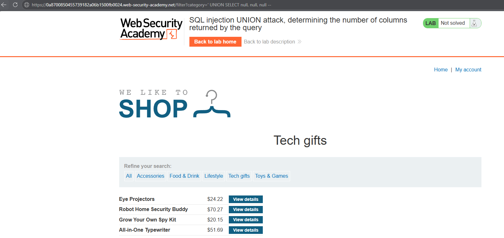
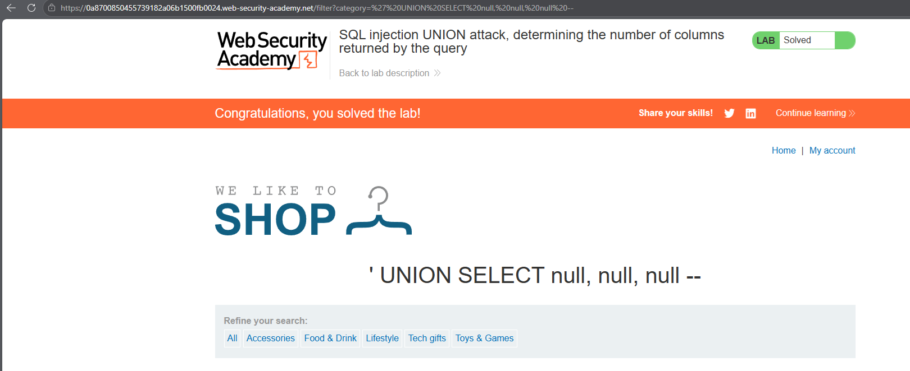

# PortSwigger Lab: SQL injection UNION attack, determining the number of columns returned by the query

## Lab Description
- **Platform:** PortSwigger Web Security Academy
- **Difficulty:** Practitioner
- **Objective:** Perform a SQL injection UNION attack that determines the number of columns returned by the query.

## Vulnerability Analysis
The application's `category` parameter is vulnerable to SQL injection. The backend executes a query like:
`SELECT name, description, price FROM products WHERE category = 'Gifts'`

To successfully extract data using a `UNION` attack, the injected `SELECT` statement must return the exact same number of columns as the original query. If the number of columns does not match, the database throws an error.

## Exploitation Steps
1. Intercepted the request to the category filter.
2. Began testing the number of columns by injecting incremental `NULL` values, as `NULL` is compatible with any data type.
3. Tested with one column (failed with Internal Server Error):
   ```sql
   ' UNION SELECT NULL--
   ```
4. Tested with two columns (failed with Internal Server Error):
   ```sql
   ' UNION SELECT NULL, NULL--
   ```
5. Tested with three columns (successful, page loaded normally):
   ```sql
   ' UNION SELECT NULL, NULL, NULL--
   ```
6. The successful response indicates that the original query returns exactly **three columns**.

## Evidence

### Payload Execution


### Lab Solved


## Mitigation
To prevent this, the application must use **parameterized queries (Prepared Statements)**. By separating the SQL logic from user input, the database will treat the `UNION` payload as a literal string search, preventing query structure manipulation.