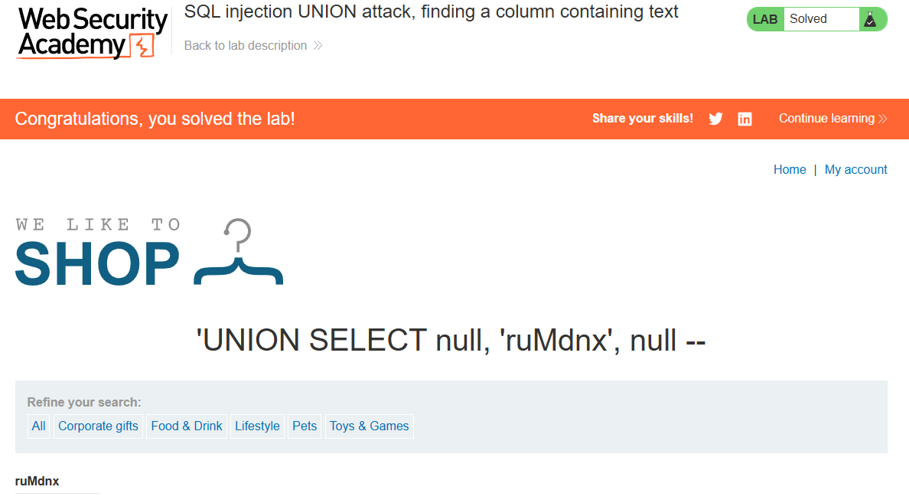

# PortSwigger Lab: SQL injection UNION attack, finding a column containing text

## Lab Description
- **Platform:** PortSwigger Web Security Academy
- **Difficulty:** Practitioner
- **Objective:** Perform a SQL injection UNION attack that determines which columns are compatible with string data.

## Vulnerability Analysis
The application is vulnerable to SQL injection in the `category` parameter. To retrieve string data (like usernames or passwords) via a `UNION` attack, we first need to identify which column in the original query accepts string data types. We already know the query returns three columns. If we try to inject a string into a column that expects a number, the database will throw an error.

## Exploitation Steps
1. Determined the number of columns in the original query (3 columns).
2. The lab provided a random string to retrieve: `'ruMdnx'`.
3. Injected the string into the first column (failed with Internal Server Error, meaning it was a numeric column):
   ```sql
   ' UNION SELECT 'ruMdnx', NULL, NULL--
   ```
4. Injected the string into the second column (successful, the string was displayed on the page):
   ```sql
   ' UNION SELECT NULL, 'ruMdnx', NULL--
   ```
5. The successful execution confirms that the **second column** is compatible with string data.

## Evidence

### Payload Execution


### Lab Solved


## Mitigation
To prevent this, the application must use **parameterized queries (Prepared Statements)**. This ensures that user input is treated strictly as data, preventing attackers from altering the query structure with `UNION` statements.