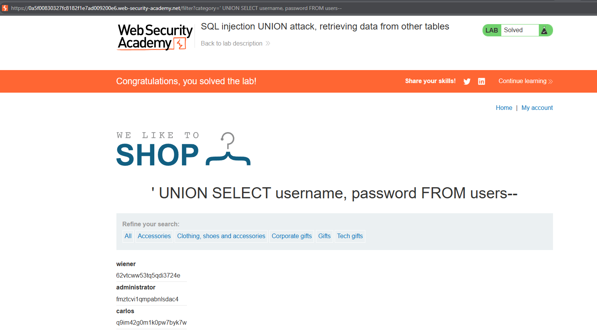
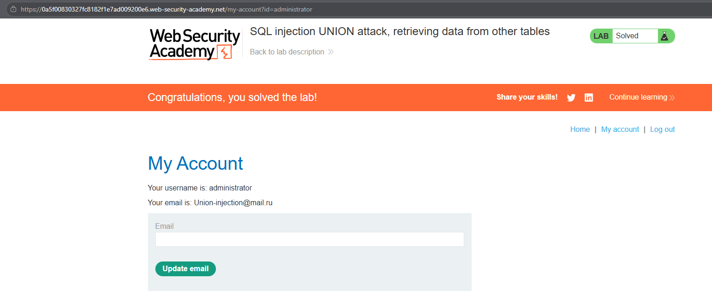

# PortSwigger Lab: SQL injection UNION attack, retrieving data from other tables

## Lab Description
- **Platform:** PortSwigger Web Security Academy
- **Difficulty:** Practitioner
- **Objective:** Perform a SQL injection UNION attack to retrieve all usernames and passwords, then log in as the `administrator` user.

## Vulnerability Analysis
The application is vulnerable to SQL injection in the `category` parameter. The database query returns two columns. The lab description hints that there is a table called `users` with columns `username` and `password`. We can use a `UNION` attack to append these values to the original query results.

## Exploitation Steps
1. Determined that the original query returns two columns.
2. Constructed the payload to extract credentials from the `users` table:
   ```sql
   ' UNION SELECT username, password FROM users--
   ```
3. Injected the payload into the URL parameter. The application displayed a list of usernames and passwords on the page.
4. Found the password for the `administrator` user.
5. Navigated to the "My Account" page and logged in with the retrieved credentials.

## Evidence

### Payload Execution (Data Exfiltration)


### Lab Solved (Logged in as Administrator)


## Mitigation
To prevent this, the application must use **parameterized queries (Prepared Statements)**. Separating user input from SQL logic prevents attackers from appending unauthorized `UNION SELECT` statements.