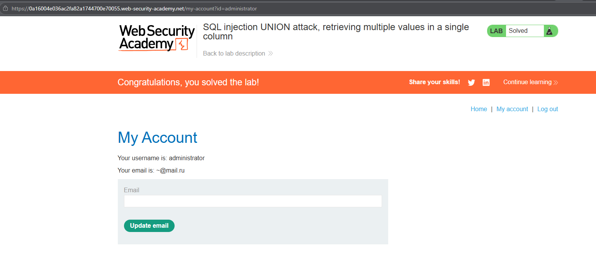

# PortSwigger Lab: SQL injection UNION attack, retrieving multiple values in a single column

## Lab Description
- **Platform:** PortSwigger Web Security Academy
- **Difficulty:** Practitioner
- **Objective:** Perform a SQL injection UNION attack to retrieve all usernames and passwords, then log in as the `administrator` user. The original query only returns one column of text.

## Vulnerability Analysis
The application is vulnerable to SQL injection in the `category` parameter. The original query returns only one column that can display string data. Because a `UNION SELECT username, password` would require two columns and throw an error, we must concatenate the username and password into a single string using the `||` operator (standard for PostgreSQL).

## Exploitation Steps
1. Determined that only one column is displayed in the query results.
2. Used the concatenation operator `||` to combine the username and password with a tilde (`~`) separator into a single column:
   ```sql
   ' UNION SELECT NULL, username || '~' || password FROM users--
   ```
   *(Note: The `NULL` fills the second column required by the original query, while our concatenated string is placed in the visible column).*
3. The application returned rows formatted like `administrator~qwerty123`.
4. Extracted the password for the `administrator` user.
5. Logged in successfully and even tested the email update functionality.

## Evidence

### Payload Execution (Data Exfiltration via Concatenation)


### Lab Solved (Logged in as Administrator)


## Mitigation
To prevent this, the application must use **parameterized queries (Prepared Statements)**. This completely neutralizes the ability to inject `UNION` clauses or manipulate the query logic, regardless of how many columns are returned.