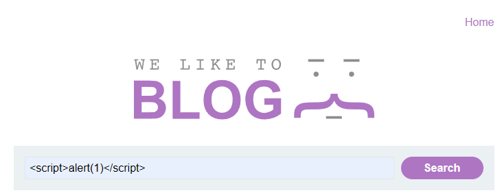
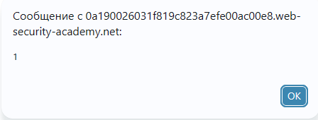
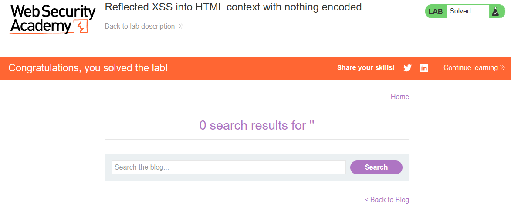

# PortSwigger Lab: Reflected XSS into HTML context with nothing encoded

## Lab Description
- **Platform:** PortSwigger Web Security Academy
- **Difficulty:** Apprentice
- **Objective:** Perform a cross-site scripting attack that calls the `alert` function.

## Vulnerability Analysis
The application's search functionality reflects the user's input directly into the HTML response without any sanitization or encoding. This means that any HTML tags or JavaScript code entered into the search field will be executed by the browser.

## Exploitation Steps
1. Navigated to the search functionality.
2. Injected the following payload into the search bar:
   ```html
   <script>alert(1)</script>
   ```
3. The server reflected the payload directly into the HTML page.
4. The browser parsed the `<script>` tag and executed the JavaScript, triggering the `alert(1)` popup.

## Evidence

### Payload Injection


### Alert Execution (PoC)


### Lab Solved


## Mitigation
To prevent Reflected XSS, the application must apply **Contextual Output Encoding** to all user input before rendering it in the HTML. Characters like `<`, `>`, and `"` must be converted to HTML entities (e.g., `&lt;`, `&gt;`, `&quot;`).