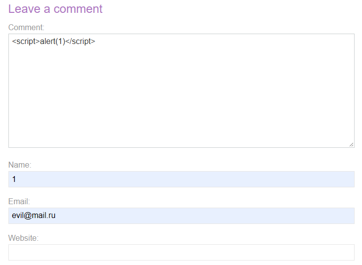
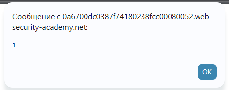
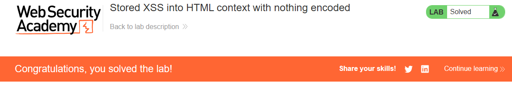

# PortSwigger Lab: Stored XSS into HTML context with nothing encoded

## Lab Description
- **Platform:** PortSwigger Web Security Academy
- **Difficulty:** Apprentice
- **Objective:** Perform a cross-site scripting attack that calls the `alert` function.

## Vulnerability Analysis
The application allows users to leave comments on blog posts. These comments are saved to the database and then rendered on the page for all visitors without any sanitization or HTML encoding. This means that an injected JavaScript payload will be permanently stored and executed in the browsers of anyone who views the page.

## Exploitation Steps
1. Navigated to a blog post and scrolled down to the "Leave a comment" section.
2. Injected the following payload into the Comment field:
   ```html
   <script>alert(1)</script>
   ```
3. Filled in the Name and Email fields, then submitted the form.
4. The application redirected to the blog post, where the payload was fetched from the database and executed, triggering the `alert(1)` popup.

## Evidence

### Payload Injection in Comment Form


### Alert Execution (PoC)


### Lab Solved


## Mitigation
To prevent Stored XSS, the application must apply **Contextual Output Encoding** when rendering the comments. The database can store the raw input, but when displaying it in HTML, characters like `<` and `>` must be converted to their HTML entities (e.g., `&lt;`, `&gt;`).