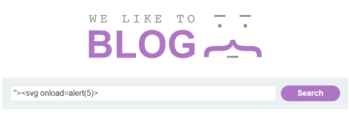
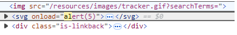
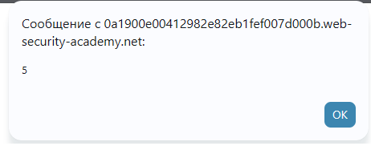

# PortSwigger Lab: DOM XSS in document.write sink using source location.search

## Lab Description
- **Platform:** PortSwigger Web Security Academy
- **Difficulty:** Apprentice
- **Objective:** Perform a DOM-based cross-site scripting attack that calls the `alert` function.

## Vulnerability Analysis
This lab contains a DOM-based XSS vulnerability in the search query tracking functionality. The application uses the `document.write` sink (JavaScript function) to write data from the `location.search` source (URL parameter) directly into the HTML page. Because the input is written inside an HTML attribute (``), we need to break out of the attribute context to execute JavaScript.

## Exploitation Steps
1. Performed a search for `test` and opened DevTools to inspect the DOM.
2. Noticed the input was reflected inside an `` tag's `src` attribute:
   ```html
   
   ```
3. Injected the following payload into the search bar to break out of the attribute and inject a new tag:
   ```html
   "><svg onload=alert(5)>
   ```
4. The payload closed the `src` attribute (`"`), closed the `` tag (`>`), and created a new `<svg>` tag with an `onload` event.
5. The browser executed the JavaScript, triggering the `alert(5)` popup.

## Evidence

### Payload Injection


### DOM Manipulation in DevTools


### Alert Execution (PoC)


### Lab Solved


## Mitigation
To prevent DOM XSS, the application must use safe DOM APIs (like `textContent`) instead of `document.write` or `innerHTML`. Additionally, the URL parameters (sources) should be validated and sanitized before being passed to any sinks.