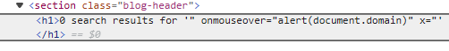
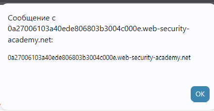

# PortSwigger Lab: Reflected XSS into attribute with angle brackets HTML-encoded

## Lab Description
- **Platform:** PortSwigger Web Security Academy
- **Difficulty:** Practitioner
- **Objective:** Perform a cross-site scripting attack that injects an attribute and calls the `alert` function.

## Vulnerability Analysis
The application reflects the user's search query inside an HTML attribute (`<input value="...">`). The server implements a basic defense by HTML-encoding angle brackets (`<` and `>`), which prevents the creation of new HTML tags (like `<script>` or `<svg>`). However, the application fails to escape double quotes (`"`), allowing an attacker to break out of the `value` attribute and inject new attributes, such as event handlers.

## Exploitation Steps
1. Performed a search for a test string and inspected the DOM to find the reflection point:
   ```html
   <input type="text" name="search" value="test">
   ```
2. Injected the following payload into the search bar:
   ```html
   " onmouseover="alert(document.domain)" x="
   ```
3. The payload used `"` to close the `value` attribute, injected the `onmouseover` event handler, and used `x="` to prevent syntax errors for the remaining quote.
4. When the user hovers the mouse over the search input, the JavaScript executes.

## Evidence

### Payload Injection in DevTools


### Alert Execution (PoC)


### Lab Solved


## Mitigation
To prevent this vulnerability, the application must apply **Contextual Output Encoding** appropriate for HTML attributes. Specifically, double quotes (`"`) must be encoded to `&quot;` to prevent breaking out of the attribute context.